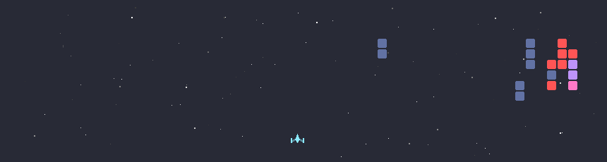

<h1 align="center">Olá, eu sou a Maria Clara 👋</h1>

  <b>Desenvolvedora de Software Júnior · Web e Mobile</b> 
  Joinville, SC · Brasil

  
  
  
  
  

  

---

### 🙋‍♀️ Sobre mim

- 🎓 Formada em **Análise e Desenvolvimento de Sistemas** (IFTM, 2025)
- 🎮 Cursando **Jogos Digitais** (UNOPAR, previsão 2028)
- 🔌 Técnica em **Eletrônica** (IFTM, 2019)
- 💼 Em busca da minha primeira oportunidade como **Dev Júnior (Web e Mobile)**
- 🚀 Atualmente construindo um **CRM multi-clientes** com Next.js, Supabase e IA

---

### 🛠️ Tecnologias

  

---

### 📌 Projeto em destaque

#### Sistema Leads MVP
CRM multi-clientes para prospecção e atendimento via WhatsApp.

- Kanban de leads, caixa de entrada em 3 colunas e importação/exportação de CSV
- Isolamento entre clientes com papéis (admin da agência, gestor, atendente)
- Busca de empresas via OpenStreetMap
- Autoresponder e prospecção assistida com IA (Groq / Gemini)
- Integração com Google Agenda para agendamento e lembretes
- Agendador com GitHub Actions + deploy contínuo na Vercel

`Next.js` `Supabase` `PostgreSQL` `Vercel` `GitHub Actions` `IA generativa`

---

### 📊 Estatísticas

  
  

  

---

### 🚀 Contribuições

<!-- Nave (czl9707/gh-space-shooter) destruindo o gráfico de contribuições -->

  

<!-- Para usar a cobrinha (Platane/snk) no lugar da nave, troque o bloco acima por este:

  <picture>
    <source media="(prefers-color-scheme: dark)" srcset="https://raw.githubusercontent.com/mari-brene/mari-brene/output/github-snake-dark.svg">
    <source media="(prefers-color-scheme: light)" srcset="https://raw.githubusercontent.com/mari-brene/mari-brene/output/github-snake.svg">
    
  </picture>

-->

<!-- Para usar o Pac-Man no lugar da cobrinha, troque o bloco acima por este:

  <picture>
    <source media="(prefers-color-scheme: dark)" srcset="https://raw.githubusercontent.com/mari-brene/mari-brene/output/pacman-contribution-graph-dark.svg">
    <source media="(prefers-color-scheme: light)" srcset="https://raw.githubusercontent.com/mari-brene/mari-brene/output/pacman-contribution-graph.svg">
    
  </picture>

-->
